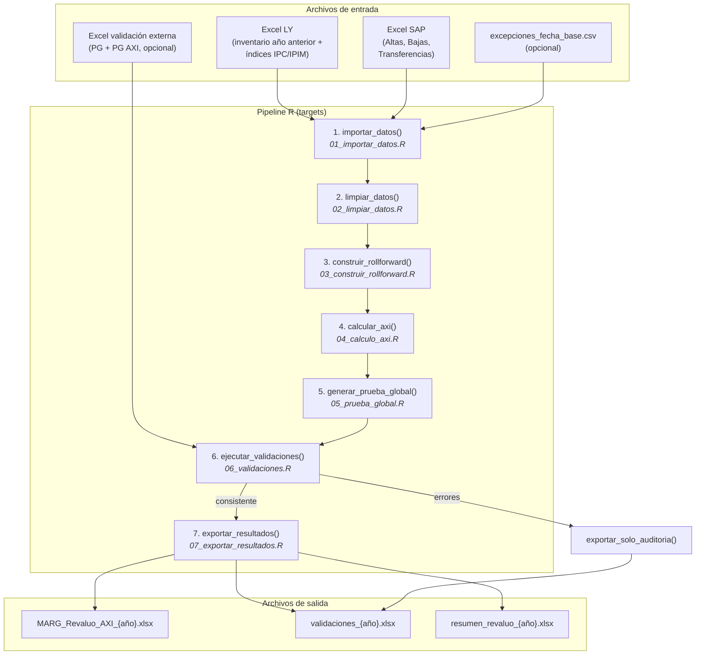
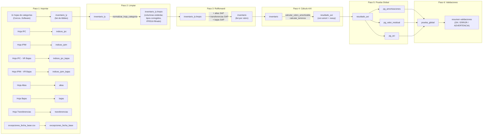

# T0.2 — Flujo de Ejecución de Punta a Punta

## Diagrama general (Mermaid)

## Diagrama de flujo de datos detallado (Mermaid)

---

## Orden de ejecución detallado

### Paso 1 — `importar_datos()` (`01_importar_datos.R:397`)

**Entrada:**
- `path_excel_ly`: ruta al Excel del año anterior
- `inputs_dir`: directorio de inputs (default `"inputs"`)

**Secuencia interna:**
1. `obtener_rutas_inputs()` → resuelve `inputs/SAP` e `inputs/parametros`
2. `leer_inventario_categorias(path_excel_ly)` → itera las 11 hojas de `HOJAS_CATEGORIAS`, llama `leer_hoja_categoria()` para cada una
3. `leer_indices_ipc(path_excel_ly)` → lee hoja "IPC", 4 columnas
4. `leer_indices_ipim(path_excel_ly)` → lee hoja "IPIM", 4 columnas
5. `leer_indices_ipc_bajas(path_excel_ly)` → lee hoja "IPC - VR Bajas"
6. `leer_indices_ipim_bajas(path_excel_ly)` → lee hoja "IPIM - VR Bajas"
7. `leer_excepciones_fecha_base(path_parametros)` → lee CSV si existe
8. Busca archivos `.xlsx` en `inputs/SAP/` → `leer_movimientos_sap()` con el primero que encuentra

**Salida:** Lista con inventario_ly, indices (4 tablas), excepciones, altas, bajas, transferencias, auditoria_movimientos.

---

### Paso 2 — `limpiar_datos()` (`02_limpiar_datos.R:149`)

**Entrada:** resultado del Paso 1 + `anio_ejercicio`

**Secuencia interna:**
1. Para cada rubro en `inventario_ly`:
   - `normalizar_hoja_categoria()` → detecta columnas por regex (`grep("activo.?fijo|n.*activo", ...)`) y las mapea a nombres estándar
   - `detectar_tipo_movimiento()` → clasifica filas por texto de primera columna (regex sobre "Altas", "Bajas", etc.)
   - Reclasifica movimientos: si son del ejercicio actual → mantiene tipo; si son de años anteriores → marca como "historico"
   - `filtrar_ifrs16()` → excluye activos con nro_activo_fijo que empiece con "AS"
   - Filtra filas de totales, notas, y filas vacías

**Salida:** `datos_limpios` con inventario_ly limpio (misma estructura, columnas estandarizadas).

---

### Paso 3 — `construir_rollforward()` (`03_construir_rollforward.R:3`)

**Entrada:** datos limpios + `anio_ejercicio`

**Secuencia interna:**
1. Detecta si el inventario LY ya contiene movimientos del año actual (`tiene_mov_anio`)
2. Para cada rubro:
   - Parte del inventario LY
   - Si NO tiene movimientos del año: incorpora altas SAP (`normalizar_movimiento_sap()`), transferencias SAP, bajas SAP (`normalizar_baja_sap()`)
   - Si SÍ tiene movimientos del año: no agrega SAP (evita duplicados)
3. Para rubros que no están en el inventario LY pero sí tienen movimientos SAP: crea entradas nuevas

**Decisiones clave:**
- **Altas:** `vo = abs(mov$valor)` — siempre positivo (`03_construir_rollforward.R:125`)
- **Transferencias:** usa `cap_date_parsed` como fecha de referencia (`03_construir_rollforward.R:112`)
- **Bajas:** `fecha_alta = posting_date` (fecha de la baja), `anio_alta/mes_alta = cap_date_parsed` (fecha original) (`03_construir_rollforward.R:151-153`)

**Salida:** `inventario` — lista por rubro con todos los activos + movimientos del ejercicio.

---

### Paso 4 — `calcular_axi()` (`04_calculo_axi.R:9`)

**Entrada:** datos del rollforward + `anio_ejercicio`

**Secuencia interna:**
1. Para cada rubro:
   - Si es terreno → `calcular_terrenos()`: sin amortización, solo reexpresión
   - Si no → `calcular_rubro_amortizable()`:
     1. `aplicar_excepciones_fecha_base()` → setea `fecha_indice_reexp`
     2. Calcula `trim_primer_anio`: para Edificios = `4 - floor((mes-1)/3)`; para otros = 1
     3. Calcula `vut_ly` (si no viene del LY): `calcular_vut_ly()` → trimestres → divide por 4 × periodos_por_anio
     4. Calcula `vut_ejercicio`: min(periodos_disponibles, vu_asignada - vut_ly)
     5. `amort_trimestre = vo / vu_asignada`
     6. `amort_hist_ejercicio = amort_trimestre × vut_ejercicio` (solo si vut_ly < vu_asignada)
     7. `amort_acum_cierre = amort_trimestre × vut_cierre`
     8. `vr = vo - amort_acum_cierre`
     9. Busca coeficientes: `coef_ipc` (para ≥2018), `coef_ipim` (para todos)
     10. Reexpresa: `vo_reexp`, `amort_hist_reexp`, `amort_acum_ly_reexp`, `amort_acum_cierre_reexp`, `vr_reexp`
     11. Calcula ajuste VU agotada (`amort_bs_agotaron_vu_ly`)
     12. `calcular_bajas_reexp()` → reexpresión específica para bajas con índices de bajas

**Salida:** `resultado_axi` — lista por rubro con todas las columnas de cálculo.

---

### Paso 5 — `generar_prueba_global()` (`05_prueba_global.R:1`)

**Entrada:** resultado AXI + `anio_ejercicio`

**Secuencia interna:**
1. `generar_pg_amortizaciones()`: por rubro, calcula amort_inicio + amort_altas + amort_transferencias + amort_bajas + bs_agotaron_vu_ly + amort_hist_ejercicio = amort_prueba; compara con amort_revaluo
2. `generar_pg_valor_residual()`: por rubro, calcula vr_inicio + altas + transf - bajas - amort_ejercicio = vr_prueba; compara con vr_revaluo
3. `generar_pg_axi()`: por rubro, calcula vr_reexp, vo_reexp, amort_acum_reexp, vr_hist, axi_resultado = vr_reexp - vr_hist

**Salida:** `prueba_global` con 3 tibbles (amortizaciones, valor_residual, axi).

---

### Paso 6 — `ejecutar_validaciones()` (`06_validaciones.R:1`)

**Entrada:** datos con PG + pg_real (opcional)

**Validaciones ejecutadas (en orden):**
1. Consistencia interna: amort_acum == amort_trim × vut_cierre; VR == VO - amort_acum
2. PG amortizaciones: diferencia < $1 (OK), $1-$100 (ADVERTENCIA), >$100 (ERROR)
3. PG valor residual: mismas tolerancias
4. VR reexpresado: vr_reexp == vo_reexp - amort_acum_cierre_reexp
5. Conteos movimientos SAP vs esperados
6. Valores reexpresados negativos
7. Excepciones de fecha base aplicadas
8. Comparación contra referencia externa (si se proporcionó): tolerancia 20%

**Salida:** `validacion` con consistente (bool), resumen, errores, advertencias.

---

### Paso 7 — `exportar_resultados()` (`07_exportar_resultados.R:9`)

**Entrada:** datos validados + `outputs_dir` + `anio_ejercicio`

**Decisión:** si `validacion$consistente == TRUE` → exporta todo; si FALSE → solo auditoría.

**Archivos generados:**
1. `MARG_Revaluo_AXI_{año}.xlsx`: una hoja por rubro (detalle activo por activo), hojas PG y PG AXI, hojas de índices
2. `validaciones_{año}.xlsx`: resumen de validaciones con formato condicional
3. `resumen_revaluo_{año}.xlsx`: AXI por rubro con totales

---

## Pasos manuales identificados

| Paso manual | Ubicación | Descripción |
|---|---|---|
| Seleccionar año de ejercicio | `_targets.R:6-13` / `app.R:221` | Variable de entorno o input numérico en Shiny |
| Colocar Excel LY en ruta correcta | `_targets.R:14-17` | Ruta hardcodeada con patrón de nombre |
| Colocar Excel SAP en `inputs/SAP/` | `01_importar_datos.R:407` | Se toma el primer `.xlsx` del directorio |
| Colocar Excel de validación | `_targets.R:26-28` | Busca por patrón de año en `inputs/parametros/` |
| Crear CSV de excepciones | Manual | Archivo `inputs/parametros/excepciones_fecha_base.csv` |
| Revisar validaciones | Post-ejecución | Las advertencias de PG requieren revisión manual |
| Decidir si exportar con errores | `_targets.R:32-38` | Automático: errores → solo auditoría |

## Parámetros que hay que cambiar entre años

| Parámetro | Dónde se define | Qué cambiar |
|---|---|---|
| `ANIO_EJERCICIO` | `_targets.R:6` / env var / Shiny | Año del ejercicio a calcular |
| `PATH_EXCEL_LY` | `_targets.R:14` | Ruta al Excel del año anterior (patrón de nombre hardcodeado) |
| `CONTEOS_MOVIMIENTOS_ESPERADOS` | `utils.R:44` | Conteos esperados de altas/bajas/transf del año |
| Índices IPC/IPIM | Dentro del Excel LY | Las tablas de índices deben incluir los del año en curso |
